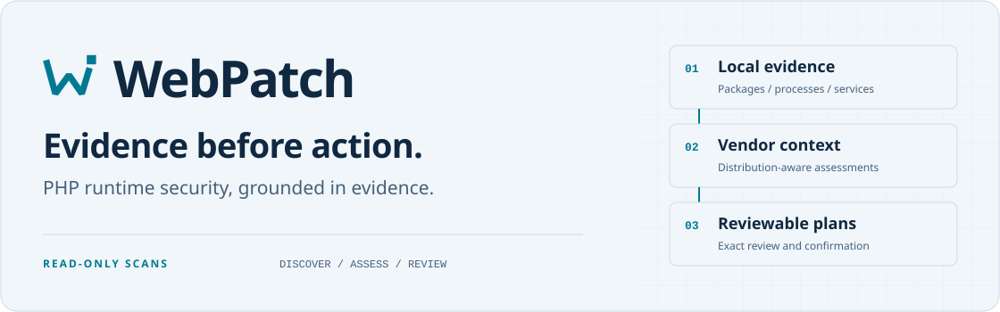
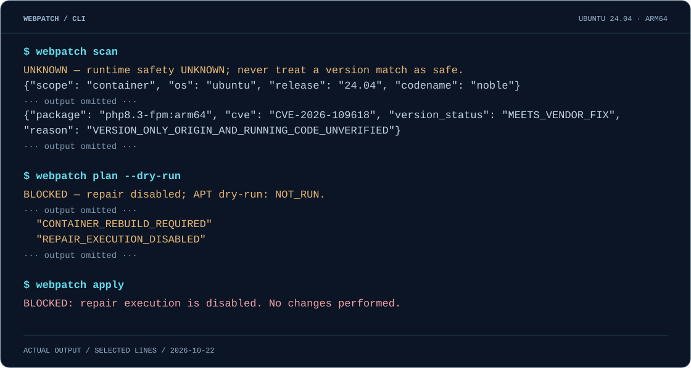

<p align="center">
  <picture>
    <source media="(max-width: 600px) and (prefers-color-scheme: dark)" srcset="assets/readme/hero-mobile-dark.svg">
    <source media="(max-width: 600px)" srcset="assets/readme/hero-mobile-light.svg">
    <source media="(prefers-color-scheme: dark)" srcset="assets/readme/hero-dark.svg">
    
  </picture>
</p>

<p align="center">
  <a href="https://github.com/ninex98/webpatch/actions/workflows/ci.yml"></a>
  <a href="https://github.com/ninex98/webpatch/releases/tag/v0.2.0"></a>
  <a href="LICENSE"></a>
</p>

<p align="center">
  <a href="#commands">常用命令</a> · <a href="#quick-start">安装升级</a> · <a href="#cli-preview">预览</a> · <a href="docs/cli.md">CLI 参考</a> · <a href="README.md">English</a>
</p>

# WebPatch

**Evidence before action. 先有证据，再采取行动。** 一个审慎的 PHP 运行时安全 CLI：发现本地安装，依据厂商公告比对包版本，生成可供审阅的修复计划。

**Linux 预览版。** [已发布版本](https://github.com/ninex98/webpatch/releases)包含有时效的规则及明确的支持范围。 扫描保持只读；显式服务准备在精确计划 hash 确认后可以重启声明的服务。包修复要求完整受控证据及所审阅计划的精确 hash 确认。内置规则聚焦 PHP2Shell（`CVE-2026-109618` / `CVE-2026-109619`）；包版本符合修复边界，不等于正在运行的服务安全。

## 为什么选择 WebPatch

终端里的 PHP，未必是处理网站请求的 PHP。发行版可能将修复回移植到旧版本，而运行中的进程也可能仍持有更新前的映像。

WebPatch 关联**包、进程、服务与本地证据**，分别呈现版本判断、文件身份和运行时安全状态，并将缺失的证明明确标为 `UNKNOWN`。

<a id="commands"></a>

## 常用命令

安装后主要使用下面这些命令。日常顺序是 **扫描 → 必要时展开详情 → 引导修复**，不用手工创建 JSON 文件。

| 命令 | 做什么 / 会看到什么 | 是否修改系统 |
| :--- | :--- | :--- |
| `webpatch --version` | 显示当前实际调用的版本；遇到“不认识某个参数”时先查这一项 | 否 |
| `webpatch scan` | 检查本机 PHP，展示检查结论、可能受影响的软件包、证据缺口和下一步 | 否，只读 |
| `webpatch scan --lang zh` | 同样的检查，使用中文显示结果 | 否，只读 |
| `webpatch scan --details` | 展开具体缺口、证据检查和需要进一步核实的内容 | 否，只读 |
| `webpatch plan` | 预览候选软件包变更、APT 模拟结果和阻断原因，不安装软件包 | 否，只读 |
| `webpatch fix --dry-run` | 预先检查修复条件；不请求探针、不要求确认、不创建会话文件 | 否，只读 |
| `sudo webpatch fix` | 进入 PHP 引导修复，展示变更和服务中断，自动保存审阅与恢复记录 | **精确确认后可能修改**：准备/重启服务、更新软件包 |
| `webpatch scan-node` | 检查受支持的 Node.js 运行时规则；不检查 npm 应用依赖，也不修复 Node | 否，只读 |
| `webpatch scan --format json` | 输出给脚本使用的结构化报告，日常操作不需要使用 | 否，只读 |
| `webpatch --help` / `webpatch fix --help` | 查看命令列表，或某一条命令的参数说明 | 否 |

希望修复提示也用中文，运行 `sudo webpatch fix --lang zh`。加 `--color never` 可关闭颜色，自动颜色模式也遵守 `NO_COLOR`。引导修复仍要求受支持的官方软件包、认证归档证据及预部署的验证探针；缺少条件会说明原因并停止。

### 结果怎么看

| 结果 | 含义 / 下一步 |
| :--- | :--- |
| `需要处理` / `ATTENTION` | 至少一个已观察到的软件包版本低于厂商修复线，可能受影响；查看详情和修复条件。 |
| `UNKNOWN` | 证据不足，既不能据此认定安全，也不能直接认定存在漏洞；用 `scan --details` 查看缺什么。空清单不代表 PHP 不存在。 |
| `BLOCKED` | 当前步骤未获准执行，或命令本身只用于审阅；查看阻断原因及准备/变更状态。 |
| `PARTIAL` / `RESTART_REQUIRED` | 系统可能已经发生部分变更；先查看恢复记录再继续，不会自动回滚。 |
| `VERIFIED_WITHIN_DECLARED_SCOPE` | 这次确认的操作在审阅范围内通过验证，不代表整台服务器都安全。 |

扫描退出码 **1** 表示发现可能受影响的包，**2** 表示未知或覆盖不足；审阅命令、被阻断或取消的修复通常返回 **4**。这些评估结果与下载/安装失败不同。[完整退出码及高级命令](docs/cli.md)。

<a id="quick-start"></a>

## 快速开始

在 **Ubuntu 22.04/24.04 或 Debian 12/13** 上，整段复制执行即可安装或升级。脚本完整下载后才执行，下载失败会停止：

```sh
(
  set -eu
  webpatch_tmp=$(mktemp -d)
  trap 'rm -rf "$webpatch_tmp"' EXIT
  curl -fsSL --retry 5 --retry-all-errors --retry-max-time 180 \
    --connect-timeout 15 --max-time 60 \
    --proto '=https' --proto-redir '=https' --tlsv1.2 \
    https://github.com/ninex98/webpatch/releases/latest/download/install.sh \
    -o "$webpatch_tmp/install.sh"
  sh "$webpatch_tmp/install.sh"
  /usr/bin/webpatch --version
)
```

安装需要 `curl`、可信 CA 证书，以及 root 或 sudo 的 APT 安装权限。脚本会校验下载摘要和包身份；缺少 Python 3.10+ 时由 APT 安装所需依赖。无需 Git、虚拟环境或 pip。[指定版本、升级和卸载](docs/installation.md) · [源码开发](CONTRIBUTING.md)。

先确认最后打印的版本为 **0.2.0 或更高**，再执行 `webpatch scan --lang zh`。如果下载失败，原来的安装不会因此变成新版；请看[下载/TLS 错误处理](docs/installation.md#download-troubleshooting)。`--lang` 和 `fix` 需要 0.2.0 或更高版本。

扫描不需要 root，受限读取会成为覆盖缺口。发现潜在受影响包时退出码为 **1**，未知或覆盖不完整时为 **2**；二者均不代表安全检查通过。

如果扫描发现可能受影响的软件包，进入引导式修复：

```sh
sudo webpatch fix
```

工具会先检查修复条件，解释阻断原因，自动管理审阅文件与恢复收据。只有受支持且证据完整时，才展示软件包变更和服务中断并要求精确确认。证据不足会停止并说明需要核实什么。各服务路由需要先部署已审阅的验证探针；向导不会创建网页或猜测应用路由。

需要查看详细原因时，运行 `webpatch scan --details`；`webpatch plan` 可直接预览升级证据，不修改系统。加上 `--lang zh` 可使用中文，终端颜色自动适配并尊重 `NO_COLOR`。JSON 导出保留给[高级自动化](docs/cli.md)，引导流程无需手工生成文件。

<a id="cli-preview"></a>

## 命令行预览

<p align="center">
  <picture>
    <source media="(max-width: 600px)" srcset="assets/readme/terminal-mobile.svg">
    
  </picture>
</p>

于 **2026-10-23** 在隔离的 **Ubuntu 24.04 / arm64 容器**中采集，展示已安装 **0.2.0 CLI** 的完整输出。示例没有 PHP 软件包，直接解释覆盖不足及下一步。CLI 支持终端颜色和按宽度换行；插图仅添加终端外框。[完整记录与出处](assets/readme/README.md)。

诊断流程为**发现 → 判断 → 审阅**。独立的[受控维护流程](docs/cli.md#managed-package-repair)增加显式探针、经确认的服务准备、完整源码包组计划、持锁复核和修复后验证。安装后的 CLI 已在八个受支持的 Ubuntu/Debian 服务 profile 通过真实升级；显式重启后故障测试保持部分失败状态。

## 核心能力

- **本地运行时发现。** 关联 dpkg 包、进程身份、命名空间、systemd 单元、FPM pools 和静态 Web handler，并报告无法确认的关系。
- **尊重厂商修复策略。** 使用发行版专属规则和 `dpkg --compare-versions`，识别回移植修复，不直接比较上游版本字符串。
- **Ubuntu 与 Debian 归档身份检查。** 对支持的官方源验证已有 InRelease 签名、Packages 摘要、缓存 `.deb` 和受支持运行文件；证据缺失时保持未知。
- **真实 APT 模拟。** 针对认证的 Ubuntu/Debian 同 PHP 分支精确候选生成计划，列出依赖变化、可能的服务中断和阻断原因，不安装软件包。
- **独立扩展。** `scan-node` 覆盖两项已审阅的 Debian Node 运行时 CVE；`rebuild-plan` 提供容器重建建议，不构建或部署镜像。
- **可审阅的证据。** JSON 报告、输入摘要、有时效的计划与 `verify-plan` 漂移检查；绝不把已保存的计划数据当成命令执行。

## 兼容性

下表描述当前代码能力，不保证穷举发现。**不支持无人确认的修复；受控修复要求精确确认和全部门禁。**

| 环境 | 当前可用 | 边界 / 验证范围 |
| :--- | :--- | :--- |
| Ubuntu 22.04 / 24.04，官方 APT PHP | 发现、归档身份、APT 模拟及经确认的同分支修复 | 官方 amd64 FPM/mod_php；四格托管 VM |
| Debian 12 / 13，官方 PHP 包 | 发现、归档身份、APT 模拟及经确认的同分支修复 | 官方 amd64 FPM/mod_php；四格独立 Debian 客体及归档测试 |
| Debian 12 / 13，官方 Node.js | 独立只读清单和两项运行时 CVE 规则 | 独立原生容器测试；无 npm 依赖审计或 Node 修复 |
| Ubuntu / Debian Docker 容器内部 | 当前容器清单、重建建议 | 不原地修复、不做 APT 模拟；Docker CI 覆盖 Ubuntu 22.04 / 24.04、Debian 12 |
| 从宿主机观察 Docker / containerd | 进程、命名空间和常见 socket 线索 | 不访问 daemon、不扫描镜像、不枚举容器集群 |
| PPA / Sury、混合源、ESM、不支持的镜像源 | 源审计、可读清单及阻断项 | 不支持的信任路径；不自动修复 |
| 自编译、`/usr/local`、`/opt/php`、宝塔 | 常见路径和进程线索 | 补丁状态未知；不穷举任意安装目录 |
| CGI、FrankenPHP、LiteSpeed、PHP 内置服务器 | 可观察时提供包或进程线索 | 运行时安全未知；无专用修复支持 |
| 其他操作系统、隐藏 PID、权限受限 | 可读观察结果和覆盖缺口 | 无受支持修复路径；macOS / Windows 未经扫描目标验证 |

## 安全设计

**观察，不改变目标。** 扫描不执行 PHP、不发送 HTTP 请求、不访问容器 daemon、不刷新 APT 索引、不安装包、不重启服务。APT 模拟使用独立临时配置，不执行系统 hooks，且仍将其列为阻断项。

**规则有出处、有时效。** [内置规则](src/webpatch/data/php2shell.json) 记录 PHP、Ubuntu、Debian 官方来源、修订号、审阅时间和有效期。审阅于 **2026-10-22**，有效至 **2026-10-29 00:00 UTC**。过期或系统时间早于审阅时间时，判断降为 `UNKNOWN`。没有自动在线规则更新；延长日期前必须重新审阅来源。

**未知必须可追踪、可阻断。** `MEETS_VENDOR_FIX` 仅为包版本比较，`VERIFIED_LOCAL_ASSOCIATION` 仅为本地关联检查，均不能证明已加载配置、应用路由或健康状态。所有报告保留 `safe=false`，未知证据阻断自动修复。摘要不等于远程证明，也不能证明遭 root 入侵的主机完整性。

**执行必须经过审阅。** 计划绑定规则、作用域和观察状态，最多 30 分钟有效，可再次检查漂移。移除、降级、新增依赖、跨分支及未批准的依赖变更均阻断自动路径。`apply` 仅接受审阅后的 schema 5 受控计划及其精确 hash，没有 `--yes` 绕过开关。精确 hash 确认、类型化包执行、修复后检查和哈希链失败审计已实现，限定于已认证的有限 profile；不承诺自动回滚。

## 文档

| 资源 | 内容 |
| :--- | :--- |
| [CLI 参考](docs/cli.md)（English） | 命令、退出码、报告语义和本地打包 |
| [架构与分阶段设计](docs/design.md) | 组件边界、威胁假设和验收门禁 |
| [开发状态与证据](docs/development-status.md)（中文 / English） | 对应源码的验收、保留的失败记录及支持边界 |
| [CI 工作流](.github/workflows/ci.yml) · [实时运行记录](https://github.com/ninex98/webpatch/actions) | 17 项：fixtures、包/Node/归档容器、四格 Ubuntu VM 和四格独立 Debian 客体 |
| [视觉资源与终端记录](assets/readme/README.md)（English） | 可编辑 SVG、采集出处和可访问的文本 |

历史证据仅对应所记录的源码版本。CI 徽章跟踪 `main`，不代表运行时安全或覆盖率承诺。

<a id="roadmap"></a>

## 路线图

- **已实现：** 清单、Ubuntu/Debian 归档认证、APT 模拟、显式探针、受控准备、精确修复审阅、类型化事务和修复后验证。
- **原设计四阶段已验收：** 只读发现/规划、有限确认式 Ubuntu 修复，以及独立 Debian 修复、Node 规则和容器建议，见[最终证据及源码摘要](evidence/final-acceptance/README.md)。
- **独立扩展：** Node.js 运行时发现/规则和容器重建建议；自动镜像构建/发布、npm 修复及公开签名 APT 仓库不属于本次交付。

原设计四阶段范围见[分阶段设计](docs/design.md)。有限测试站点通过不等于任意生产站点认证。

## 参与贡献

请先阅读 [CONTRIBUTING.md](CONTRIBUTING.md)（English）。新增适配器须明确能力边界，提供失败路径 fixtures 和真实环境证据。开发与安装测试使用项目虚拟环境、一次性容器及 GitHub 托管 VM。

## 许可证

[Apache License 2.0](LICENSE)。名称与本地 SVG 可独立于 CLI 调整；本次展示设计不改变既有许可证或发布策略。
